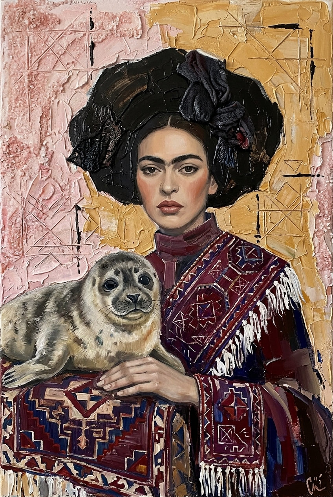
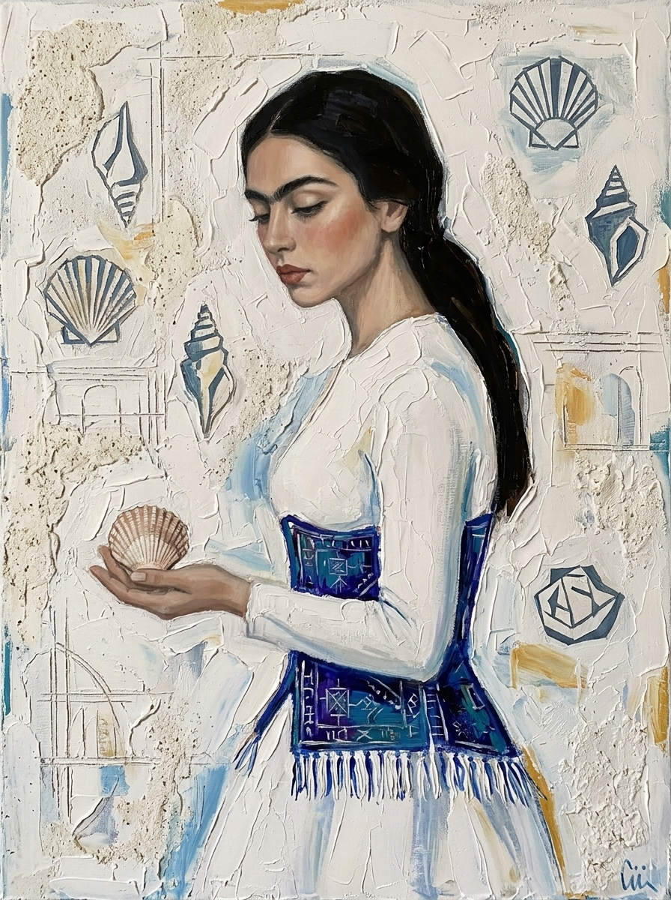
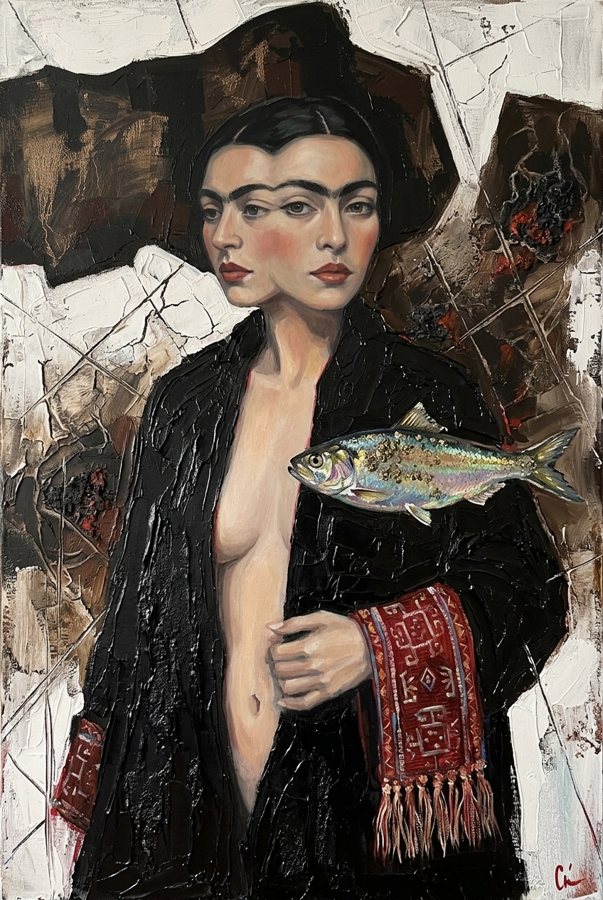
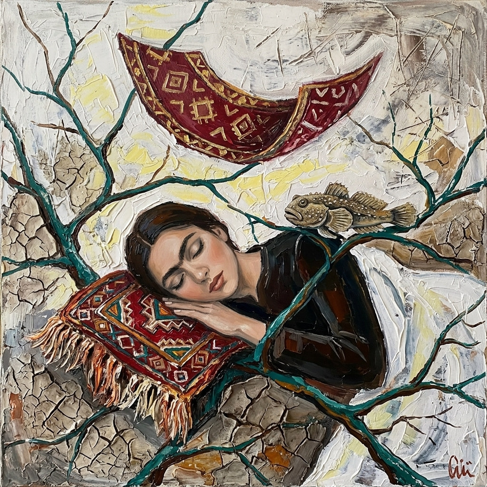
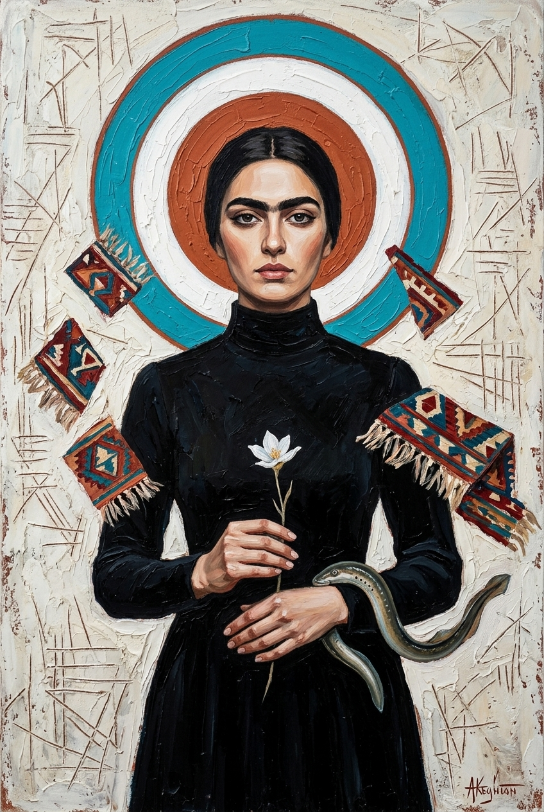

# Gazelli Art House Exhibition Proposal (Attempt 1: Figurative Portraits)
## *Absheron Harmonies: Echoes of the Caspian Basin*

### Curatorial Concept & Artistic Vision
This series of five figurative works synthesizes the distinct portraiture language of **Mirgasim** with the geological, historical, and ecological soul of the Absheron Peninsula and the Caspian Sea.

Mirgasim’s iconic visual hallmarks—melancholic, statuesque figurative muses, connected dark brows, sculpted hands, heavy palette-knife impasto, linear sgraffito incisions, and collaged Azerbaijani carpet/kilim fragments with fringes—are combined with endemic Caspian wildlife and authentic raw geological materials extracted directly from the Absheron landscape (Masazir salt, mud-volcano clay, coquina limestone, natural bitumen, and pyrite).

---

## Catalog of Artworks

### 1. *The Solitary of Masazir* (*Masazır Tənha*)

- **Dimensions**: 100 × 150 cm (Portrait, Painting Spec from Brief)
- **Endemic Caspian Wildlife**: Caspian Seal (*Pusa caspica*)
- **Selected Materials**: Masazir Lake Salt, Absheron Limestone & Coquina, Natural Bitumen.
- **Concept**: A contemplative Azerbaijani muse in an elaborate sculptural dark headdress embraces a gentle Caspian seal pup against a fringed crimson kilim shawl.

---

### 2. *The Weaver of Sunken Shells* (*Didacna Elegiyası*)

- **Dimensions**: 150 × 200 cm (Portrait, Painting Spec from Brief)
- **Endemic Caspian Wildlife**: Caspian Cockle (*Didacna trigonoides* / *Didacna pyramidata*)
- **Selected Materials**: Coquina (Shell Limestone), Absheron Beach Sand, Caspian Cockle Shells.
- **Concept**: Depicted in graceful profile, the muse wears an architectural corset structured from a handwoven azure-and-indigo Azerbaijani rug fragment with hanging fringe tassels, cradling an ancient Didacna cockle shell.

---

### 3. *Keeper of the Cold Depths* (*Qara Su və Qızıl Şad*)

- **Dimensions**: 120 × 200 cm (Portrait, Painting Spec from Brief)
- **Endemic Caspian Wildlife**: Caspian Marine Shad / Brazhnikov’s Shad (*Alosa braschnikowi*)
- **Selected Materials**: Natural Bitumen (Fatmai / Binagadi), Pyrite Aggregates, Mud-Volcano Clay.
- **Concept**: A double-faced muse gazes simultaneously inward and forward, draped in bitumen-stained robes with an ornate red kilim cuff, communing with a levitating Caspian marine shad with glistening pyrite ore.

---

### 4. *Whisper of the Mud Volcano* (*Palçıq Vulkanının Yuxusu*)

- **Dimensions**: 180 × 180 cm (Square, Painting Spec from Brief)
- **Endemic Caspian Wildlife**: Caspian Tadpole Goby (*Benthophilus* spp.)
- **Selected Materials**: Mud-Volcano Clay (Absheron ejecta), Absheron Limestone, Natural Bitumen.
- **Concept**: A peaceful, dreaming muse reclines her cheek against an ornate miniature Azerbaijani carpet pillow with dangling wool tassels, with an endemic Caspian tadpole goby perched on a branch beside her.

---

### 5. *The Lamprey's Vigil* (*Xəzər İlanbalığının Keşikçisi*)

- **Dimensions**: 100 × 150 cm (Portrait, Painting Spec from Brief)
- **Endemic Caspian Wildlife**: Caspian Lamprey (*Caspiomyzon wagneri*)
- **Selected Materials**: Absheron Limestone, Caspian Coastal Sand, Masazir Lake Salt, Natural Bitumen.
- **Concept**: A frontal portrait of an Azerbaijani muse with connected brow, holding a white coastal flower as a primitive Caspian lamprey coils protectively along her wrist, framed by a concentric halo target and floating Shirvan carpet fragments.
