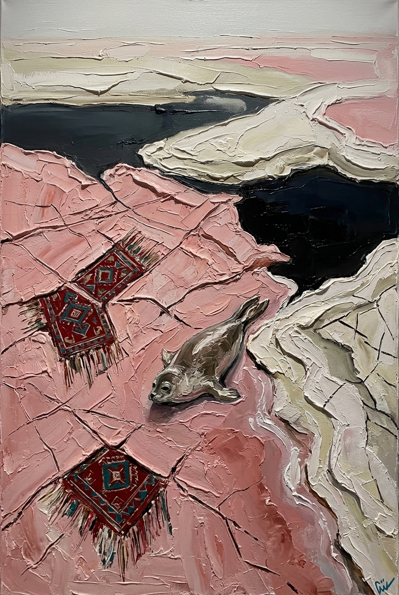
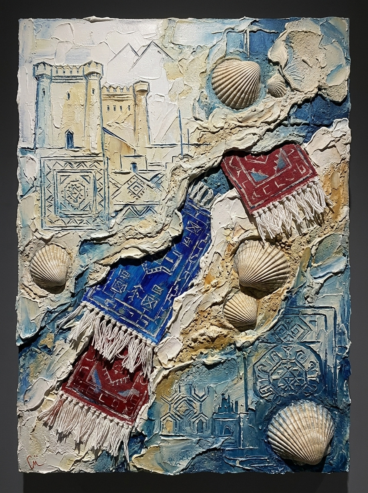
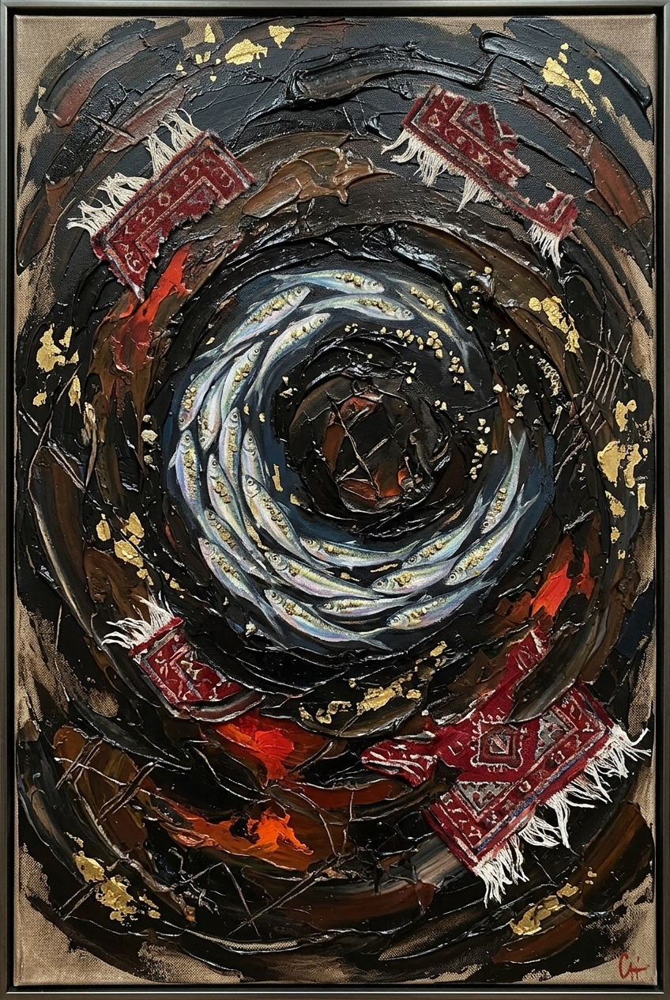
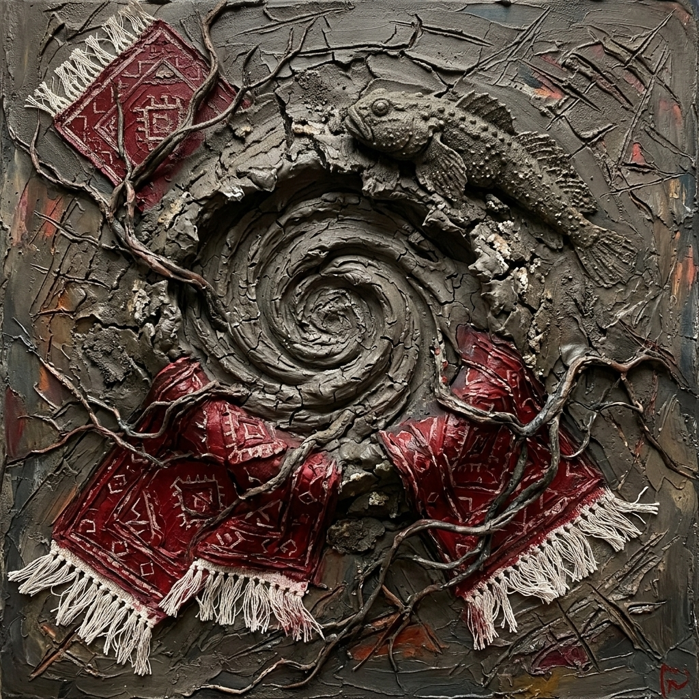
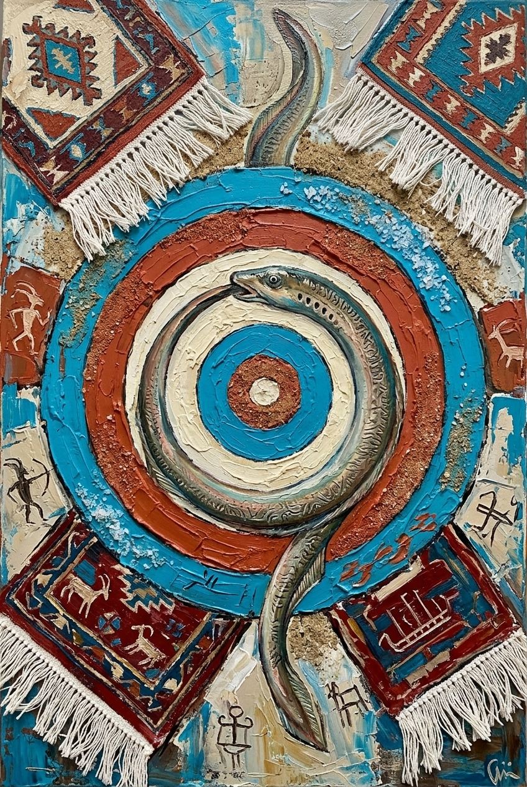

# Gazelli Art House Exhibition Proposal
## *Absheron Tectonics: Primordial Matter & The Inland Sea*

### Curatorial Statement & Vision
Departing from conventional representation, this series of five monumental works synthesizes the distinctive visual language of **Mirgasim**—heavy sculptural palette-knife impasto, deep linear sgraffito incisions, raw mineral materiality, and deconstructed Azerbaijani textile motifs—with the ancient geological and ecological soul of the Absheron Peninsula and the Caspian Sea.

Conceived specifically for the curatorial standards of **Gazelli Art House**, the series expands beyond traditional portraiture into diverse, cutting-edge contemporary genres:
- **Tectonic Abstract Landscapes** (Masazir Salt Flats)
- **Stratigraphic Paleontological Wall Reliefs** (Coquina & Didacna Fossil Strata)
- **Hydrocarbon Abyssal Vortices** (Binagadi Bitumen, Caspian Shad & Pyrite Ore)
- **Radical Volcanic Earth-Art** (Lokbatan Crater Craquelure & Armored Goby)
- **Mythological Petroglyphic Mandalas** (Ouroboros Caspian Lamprey & Concentric Mineral Halos)

Each piece physically incorporates authentic raw materials harvested from the Absheron environment alongside endemic Caspian species, establishing a visceral dialogue between Azerbaijan's hydrocarbon heritage, prehistoric rock art, and contemporary fine art abstraction.

---

## Catalog of Artworks

### 1. *Tides of Masazir: The Submerged Witness* (*Masazır Çəhrayı Duzları və Şahid*)

- **Genre**: Tectonic Abstract-Geological Landscape
- **Dimensions**: 100 × 150 cm (Portrait, Painting Specification from Brief)
- **Endemic Caspian Wildlife**: Caspian Seal (*Pusa caspica*)
- **Selected Absheron Materials**:
  - **Masazir Pink Lake Salt**: Crystalline lake salt encrusted directly into the gesso ground and palette-knife impasto, creating real saline crystallization.
  - **Absheron Limestone & Shell Coquina**: Pulverized into the chalky white ridges and bone-colored shoreline.
  - **Natural Bitumen**: Liquid asphaltite used to paint the dark abyssal pool and fault lines.
- **Curatorial Narrative**:
  An aerial-perspectival landscape capturing the surreal blush-pink salt plains of Lake Masazir meeting the ink-black depths of the Caspian shoreline. Emerging from the crystalline salt flats is the solitary, primordial form of the Caspian seal (*Pusa caspica*), while deconstructed fragments of Shirvan kilim carpets with hand-knotted white fringes are scored directly into the tectonic salt crust like ancient sacred channels.

---

### 2. *Paleotethys Archives: Reliquary of the Inland Sea* (*Didacna: Qədim Dənizin Arxivləri*)

- **Genre**: Stratigraphic Architectural Matter Relief
- **Dimensions**: 150 × 200 cm (Vertical Monumental Canvas, Specification from Brief)
- **Endemic Caspian Organism**: Caspian Cockle (*Didacna trigonoides* / *Didacna pyramidata*)
- **Selected Absheron Materials**:
  - **Coquina (Shell Limestone)**: Porous shell-rich quarry limestone built up into a high-relief architectural frieze.
  - **Absheron Coastal Beach Sand**: Coarse shell-laden coastal sand pressed into the wet mortar and oil glaze.
  - **Natural Caspian Didacna Shells**: Natural fossilized and modern Didacna bivalve shells protruding in high sculptural relief.
- **Curatorial Narrative**:
  A stratigraphic cross-section of Absheron's deep time. Carved directly into the coquina limestone impasto are the crenellations and watchtowers of Absheron fortress architecture (Mardakan and Ramana), juxtaposed with cascading azure-blue and madder-red Azerbaijani carpet weaves with long hanging fringes. Radiating Didacna cockles act as geological time capsules from the prehistoric Paratethys Sea.

---

### 3. *The Black Gold Vortex: Fire Under Water* (*Qara Qızıl və Qaranlıq Suların Cərəyanı*)

- **Genre**: Hydrocarbon Abyssal Abstraction / Dynamic Matter Painting
- **Dimensions**: 120 × 200 cm (Vertical Panoramic Canvas, Specification from Brief)
- **Endemic Caspian Wildlife**: Caspian Marine Shad / Brazhnikov’s Shad (*Alosa braschnikowi*)
- **Selected Absheron Materials**:
  - **Natural Absheron Bitumen (Fatmai & Binagadi deposits)**: Raw, viscous hydrocarbons applied in thick, knife-sculpted swirls, providing an obsidian, velvety depth.
  - **Pyrite Aggregates**: Crushed metallic mud-volcano sulfide mineral aggregates embedded into the fish scales, producing an authentic golden specular luster.
  - **Mud-Volcano Silt Clay**: Matte subterranean clay blended into the underpainting.
- **Curatorial Narrative**:
  Engaging directly with Azerbaijan’s identity as the "Land of Fire" (*Odlar Yurdu*) and cradle of the global petroleum industry, this dynamic composition depicts an oceanic maelstrom of liquid bitumen. Trapped in this abyssal vortex, a school of Caspian marine shad circles in a luminous spiral, illuminated by pyrite gold flecks and submerged fragments of burning crimson carpet weaves.

---

### 4. *Breath of Lokbatan: Volcanic Crater and Primordial Goby* (*Lökbatan Nəfəsi və Daşlaşmış Qobi*)

- **Genre**: Earth-Art Matter Painting & Tectonic Surrealism
- **Dimensions**: 180 × 180 cm (Square Format, Specification from Brief)
- **Endemic Caspian Wildlife**: Caspian Tadpole Goby (*Benthophilus* spp.)
- **Selected Absheron Materials**:
  - **Mud-Volcano Clay (Ejecta from Lokbatan / Gobustan)**: Authentic subterranean volcanic clay applied in heavy impasto and dried into genuine geological craquelure (fissures).
  - **Absheron Limestone Dust**: Integrated to add textural tooth and structural stability.
  - **Natural Bitumen & Organic Pigments**: Tracing skeletal roots and geological strata.
- **Curatorial Narrative**:
  A radical exploration of Absheron's volcanic typography. At the epicenter of a swirling mud-volcano crater rests an armored, petrified Caspian tadpole goby—an ancient endemic bottom-dweller perfectly adapted to the mineral-rich waters. Erupting through the volcanic craquelure fissures are sumptuous woven Azerbaijani carpets with knotted fringes and tangled roots, symbolizing culture springing from the primordial earth.

---

### 5. *Totem of the Caspian: The Ouroboros Mandala* (*Xəzərin Totemi: İlanbalığı və Əbədi Halə*)

- **Genre**: Mythological Totemic Icon / Contemporary Symbolist Altar Piece
- **Dimensions**: 100 × 150 cm (Portrait Specification from Brief)
- **Endemic Caspian Wildlife**: Caspian Lamprey (*Caspiomyzon wagneri*)
- **Selected Absheron Materials**:
  - **Absheron Coastal Beach Sand**: Concentric rings textured with raw Caspian beach sand.
  - **Masazir Lake Salt Crystals**: Saline clusters embedded along the cyan-blue outer orbital halo.
  - **Absheron Limestone & Bone Plaster**: Deeply scored with Gobustan-style petroglyphic sgraffito.
- **Curatorial Narrative**:
  A transcendental contemporary icon uniting prehistoric rock art with ecological mystery. The ancient Caspian lamprey—a jawless, eel-like living fossil unchanged for hundreds of millions of years—coils into a sacred Ouroboros circle of eternal return. Behind it radiates a textured sun-halo mandala flanked by floating Shirvan carpet corners with thick wool fringes, surrounded by carved Gobustan petroglyphs (shamans, archers, and sacred bulls).

---

## Technical Integration & Absheron Materiality

1. **Mineral Priming**:
   Canvases are grounded with a specialized limestone-and-coquina primer that mimics the porous facade of Baku stone architecture.
2. **True Craquelure & Salt Accents**:
   Mud-volcano clay and Masazir salt crystals are cured naturally onto the support, creating authentic 3D textural surfaces impossible to replicate with synthetic mediums.
3. **Hydrocarbon Glazing**:
   Authentic bitumen from Absheron oil seepages provides a deep, warm-toned darkness with high historical and cultural resonance.
4. **Textile Deconstruction**:
   Azerbaijani carpet motifs are deconstructed from mere decorative patterns into tectonic plates, floating celestial satellites, and archaeological friezes, honouring the national heritage with cutting-edge contemporary boldness.
