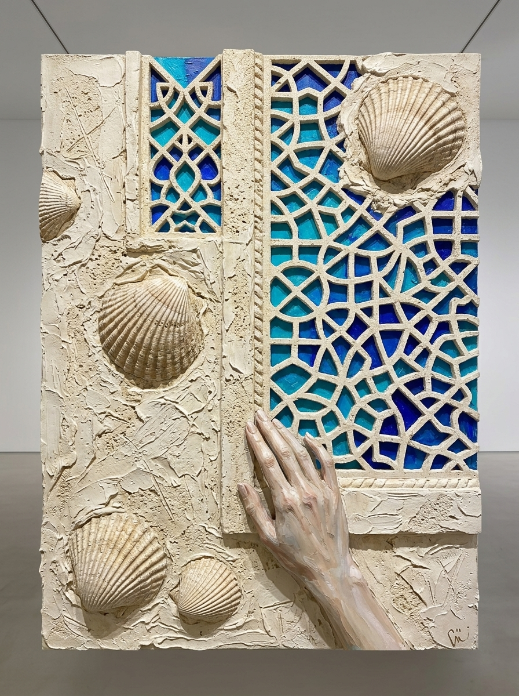

# Gazelli Art House Exhibition Proposal (Latest Active Version)
## *Absheron Tectonics: Primordial Matter & Geological Strata*

### Curatorial Statement & Vision
Responding to the highest standards of contemporary fine art at **Gazelli Art House**, this collection explores authentic Absheron signatures and Caspian endemism through the physical substances of the land:
- **Salt Monoliths & Brine Mining Architecture** (Masazir Pink Lake & Caspian Seal)
- **Carved Stone Shebeke Tracery & Paleontological Strata** (Absheron Limestone, Coquina & Fossil Didacna)
- **Industrial Hydrocarbon Scaffolding & Eternal Flames** (Binagadi Bitumen, Historic Derricks, Pyrite Ore & Marine Shad)
- **Radical Volcanic Earth-Art** (Lokbatan Crater Craquelure & Armored Caspian Goby)
- **The Gobustan Petroglyphic Solar Oracle** (Ouroboros Lamprey, Beach Sand Mandala & Incised Rock Petroglyphs)

Mirgasim’s core visual DNA—thick sculptural palette-knife impasto, tactile mineral reliefs, deep sgraffito incisions, and raw earthen contrasts—is preserved while expanding into architectural, geological, and mythic dimensions.

---

## Catalog of Artworks

### 1. *The Salt Monoliths of Masazir* (*Masazır Duz Monolitləri və Xəzər Suiti*)

- **Genre**: Minimalist Geological-Architectural Landscape
- **Dimensions**: 100 × 150 cm (Portrait, Painting Specification from Brief)
- **Endemic Caspian Wildlife**: Caspian Seal (*Pusa caspica*)
- **Selected Absheron Materials**:
  - **Masazir Pink Lake Salt**: Crystalline salt encrustations integrated directly into the impasto on the limestone shelf.
  - **Absheron Limestone**: Porous cream limestone ground and sculpted geometric salt obelisks.
  - **Natural Bitumen**: Fine dark lines tracing the weathered timber stakes and horizon.
- **Curatorial Narrative**:
  A serene, surrealist landscape capturing the blush-pink brine of Lake Masazir. Minimalist geometric monoliths and pyramids carved from salt and limestone rise from the water alongside weathered wooden brine-extraction stakes. Resting on a salt-encrusted ledge is a solitary Caspian seal, its spotted coat glistening with salt grains beneath an impasto sky scored with subtle golden solar lines. *(No carpets; pure geological-architectural minimalism).*

---

### 2. *The Shebeke Reliquary: Fossil Didacna in Absheron Stone* (*Şəbəkə Qalığı: Qədim Didakna və Daş Pəncərə*)

- **Genre**: Architectural Stone Frieze & Paleontological Matter Relief
- **Dimensions**: 150 × 200 cm (Vertical Monumental Canvas, Specification from Brief)
- **Endemic Caspian Organism**: Caspian Cockle (*Didacna trigonoides* / *Didacna pyramidata*)
- **Selected Absheron Materials**:
  - **Coquina (Shell Limestone)**: Heavy, porous quarry coquina forming the structural wall.
  - **Absheron Beach Sand**: Coastal sand mixed into the wet plaster relief.
  - **Natural Caspian Didacna Shells**: Genuine fossilized and contemporary Didacna bivalve shells protruding in high sculptural relief.
- **Curatorial Narrative**:
  Celebrating Absheron's ancient stone carving heritage (*daş yonma*), this monumental work depicts a coquina wall with an intricate geometric stone Shebeke window lattice. Behind the stone tracery glow luminous glazes of Caspian turquoise and deep lapis lazuli. Protruding from the limestone are radiant Didacna cockles, while a single elongated, sculpted hand touches the stone window frame, linking human craftsmanship with deep geological time. *(No carpets; pure architectural masonry & fossil relief).*

---

### 3. *The Binagadi Derrick: Hydrocarbon Strata & Pyrite Shad* (*Binaqədi Buruğu: Qara Qızıl və Pirit Şad*)

- **Genre**: Industrial-Geological Abstraction / Hydrocarbon Matter Painting
- **Dimensions**: 120 × 200 cm (Vertical Panoramic Canvas, Specification from Brief)
- **Endemic Caspian Wildlife**: Caspian Marine Shad / Brazhnikov’s Shad (*Alosa braschnikowi*)
- **Selected Absheron Materials**:
  - **Natural Absheron Bitumen (Binagadi & Fatmai deposits)**: Pure unrefined asphaltite applied in thick, viscous knife-strokes.
  - **Pyrite Mineral Aggregates**: Irregular metallic brassy-gold sulfide crystals embedded into the fish scales.
  - **Absheron Limestone Powder**: Providing stark, chalky white contrast against the black bitumen.
- **Curatorial Narrative**:
  Engaging directly with Baku’s historic role as the pioneer of world petroleum, this dynamic piece juxtaposes sharp, minimalist scaffolding beams inspired by historic wooden oil derricks against slabs of pitch-black bitumen. Leaping through the dark structural lines is a Caspian marine shad adorned with shimmering pyrite ore, above an eternal natural gas flame (*Yanar Dağ / Ateshgah*) burning in the foreground. *(No carpets; industrial heritage meeting abyssal marine life).*

---

### 4. *Breath of Lokbatan: Volcanic Crater and Armored Goby* (*Lökbatan Nəfəsi və Daşlaşmış Qobi*)

- **Genre**: Earth-Art Matter Painting & Tectonic Craquelure
- **Dimensions**: 180 × 180 cm (Square Format, Specification from Brief)
- **Endemic Caspian Wildlife**: Caspian Tadpole Goby (*Benthophilus* spp.)
- **Selected Absheron Materials**:
  - **Mud-Volcano Clay (Ejecta from Lokbatan / Gobustan)**: Authentic volcanic clay applied in heavy impasto and cured into deep, natural craquelure fissures.
  - **Absheron Limestone**: Porous limestone dust for structural relief.
  - **Natural Bitumen**: Fluid lines defining ancient root systems.
- **Curatorial Narrative**:
  A tactile vortex of dried mud-volcano ejecta with natural craquelure fissures. Perched on a volcanic ridge is the prehistoric, armored Caspian tadpole goby—an ancient endemic bottom-dweller whose stone-like tubercles blend into the mineral ground. Organic roots weave across the tectonic vortex, embodying the subterranean forces of Absheron.

---

### 5. *The Gobustan Solar Oracle: Ouroboros Lamprey* (*Qobustan Günəşi: İlanbalığı və Qədim Qaya Təsvirləri*)

- **Genre**: Mythological Totemic Icon / Contemporary Symbolist Altar Piece
- **Dimensions**: 100 × 150 cm (Portrait Specification from Brief)
- **Endemic Caspian Wildlife**: Caspian Lamprey (*Caspiomyzon wagneri*)
- **Selected Absheron Materials**:
  - **Absheron Coastal Beach Sand**: Concentric rings textured with raw beach sand.
  - **Masazir Lake Salt Crystals**: Saline clusters embedded along the cyan-blue outer orbital halo.
  - **Absheron Limestone & Bone Plaster**: Sgraffito incisions depicting Gobustan rock petroglyphs.
- **Curatorial Narrative**:
  A transcendental contemporary altar piece uniting prehistoric rock art with ecological mystery. The ancient Caspian lamprey coils into an Ouroboros circle of eternity around a concentric sand-and-salt mandala. Carved directly into the limestone ground are Gobustan petroglyphs (reed boats, hunters, and sacred solar bulls), immortalizing Absheron's ancient rock art heritage within deep cosmological time. *(No carpets; pure stone petroglyphs, sand mandala, and primordial marine life).*

---

## Technical Integration & Absheron Materiality

1. **Mineral Priming**:
   Canvases are grounded with an authentic limestone-and-coquina primer replicating the porous masonry of Baku.
2. **True Craquelure & Salt Accents**:
   Mud-volcano clay and Masazir salt crystals cure naturally on the support, producing authentic 3D tactile relief.
3. **Hydrocarbon & Pyrite Glazing**:
   Authentic bitumen from Absheron seepages provides deep, velvety black fields, while raw pyrite ore catches light with metallic specular highlights.
4. **Restraint & Conceptual Diversity**:
   Moving beyond repetitive decorative motifs to celebrate Absheron’s stone architecture, petroleum history, salt lakes, mud volcanoes, and ancient petroglyphs.
