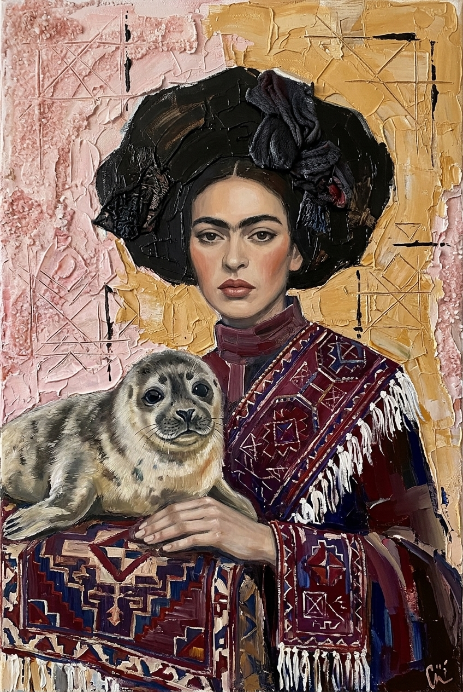
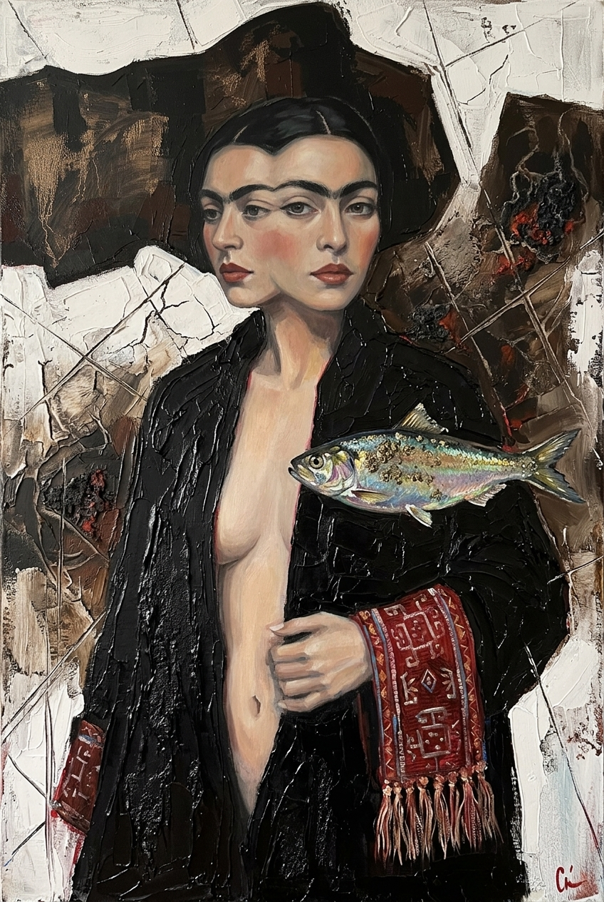

# Gazelli Art House Exhibition Proposal
## *Absheron Harmonies: Echoes of the Caspian Basin*

### Curatorial Concept & Artistic Vision
This series of five original works synthesizes the distinct visual language of **Mirgasim** with the geological, historical, and ecological soul of the Absheron Peninsula and the Caspian Sea, directly addressing the specifications set forth in the Gazelli Art House brief.

Mirgasim’s iconic visual hallmarks—melancholic, statuesque figurative muses, connected dark brows, sculpted hands, heavy palette-knife impasto, linear sgraffito incisions, and collaged Azerbaijani carpet/kilim fragments with fringes—are combined with endemic Caspian wildlife and authentic raw geological materials extracted directly from the Absheron landscape (Masazir salt, mud-volcano clay, coquina limestone, natural bitumen, and pyrite).

---

## Catalog of Artworks

### 1. *The Solitary of Masazir* (*Masazır Tənha*)

- **Dimensions**: 100 × 150 cm (Portrait, Painting Spec from Brief)
- **Endemic Caspian Wildlife**: Caspian Seal (*Pusa caspica*)
- **Selected Materials**:
  - **Masazir Lake Salt**: Coarse pink crystalline salt from Lake Masazir, mixed into the gesso ground and oil medium to form an authentic crystalline relief crust.
  - **Absheron Limestone & Coquina**: Powdered shell limestone integrated into the warm ochre-cream background impasto.
  - **Natural Bitumen**: Dark asphaltite lines tracing the architectural sgraffito grid.
- **Concept & Narrative**:
  A contemplative Azerbaijani muse in an elaborate sculptural dark headdress embraces a gentle Caspian seal pup against a fringed crimson kilim shawl. The seal, the only marine mammal endemic to the landlocked Caspian, embodies vulnerability and silent kinship. The background mimics the blush-pink crystallized shores of Masazir Lake, bridging traditional weaving with ancient natural ecology.

---

### 2. *The Weaver of Sunken Shells* (*Didacna Elegiyası*)

- **Dimensions**: 150 × 200 cm (Portrait, Painting Spec from Brief)
- **Endemic Caspian Wildlife**: Caspian Cockle (*Didacna trigonoides* / *Didacna pyramidata*)
- **Selected Materials**:
  - **Coquina (Shell Limestone)**: Coarse crushed coquina from Absheron quarries applied directly into the white structural impasto.
  - **Absheron Beach Sand & Crushed Shells**: Fine coastal beach sand embedded along the lower horizon and tactile contours.
  - **Caspian Cockle Shells**: Genuine fossilized and contemporary Didacna cockles embedded into the surface relief.
- **Concept & Narrative**:
  Depicted in graceful profile, the muse wears an architectural corset structured from a handwoven azure-and-indigo Azerbaijani rug fragment with hanging fringe tassels. In her palms she cradles an ancient Didacna cockle shell, while ghost-like geometric mollusks and Absheron architectural arches drift in the chalky, sculpted limestone ground.

---

### 3. *Keeper of the Cold Depths* (*Qara Su və Qızıl Şad*)

- **Dimensions**: 120 × 200 cm (Portrait, Painting Spec from Brief)
- **Endemic Caspian Wildlife**: Caspian Marine Shad / Brazhnikov’s Shad (*Alosa braschnikowi*)
- **Selected Materials**:
  - **Natural Bitumen (Fatmai / Binagadi deposits)**: Raw, unrefined hydrocarbon bitumen mixed with black oil pigment, imparting a velvety, deep luster to the drapery and dark geological fractures.
  - **Pyrite**: Irregular metallic aggregates of mud-volcano pyrite ground into a shimmering dust, adorning the shad's glistening scales and cracked rock fissures.
  - **Mud-Volcano Clay**: Applied in the underlayer to establish an earthy, matte ground.
- **Concept & Narrative**:
  Representing the duality of memory and identity, a double-faced muse gazes simultaneously inward and forward. Draped in bitumen-stained robes with an ornate red kilim cuff, she communes with a levitating Caspian marine shad whose scales gleam with pyrite ore. The piece evokes the ancient "eternal fires" and hydrocarbon heritage of Baku meeting the Caspian depths.

---

### 4. *Whisper of the Mud Volcano* (*Palçıq Vulkanının Yuxusu*)

- **Dimensions**: 180 × 180 cm (Square, Painting Spec from Brief)
- **Endemic Caspian Wildlife**: Caspian Tadpole Goby (*Benthophilus* spp.)
- **Selected Materials**:
  - **Mud-Volcano Clay (Absheron ejecta)**: Raw mineral clay applied in heavy impasto and dried under controlled heat to produce genuine geological craquelure (cracking) across the lower register.
  - **Absheron Limestone**: Porous limestone dust combined with titanium white for the sculptural relief.
  - **Natural Bitumen**: Fluid dark brush lines forming the skeletal branches.
- **Concept & Narrative**:
  A peaceful, dreaming muse reclines her cheek against an ornate miniature Azerbaijani carpet pillow with dangling wool tassels. Above her, turquoise-veined branches cradle an endemic Caspian tadpole goby—an ancient, armored bottom-dwelling creature—while a crescent-shaped flying kilim fragment hovers like a nocturnal moon above the dried crater mud-crust.

---

### 5. *The Lamprey's Vigil* (*Xəzər İlanbalığının Keşikçisi*)

- **Dimensions**: 100 × 150 cm (Portrait, Painting Spec from Brief)
- **Endemic Caspian Wildlife**: Caspian Lamprey (*Caspiomyzon wagneri*)
- **Selected Materials**:
  - **Absheron Limestone**: Carved and textured limestone ground treated with sgraffito incisions.
  - **Caspian Coastal Sand**: Sprinkled into the wet gesso halo and outer borders for a raw, granitic coastal feel.
  - **Masazir Lake Salt & Bitumen**: Contrasting textures between crystalline white salt circles and deep pitch-black garments.
- **Concept & Narrative**:
  A frontal, sovereign portrait of an Azerbaijani muse with an unyielding gaze and distinctive connected brow, holding a white coastal flower. A primitive Caspian lamprey coils protectively along her wrist like a sacred talisman. Behind her head radiates a concentric halo target in Caspian teal, salt white, and terracotta, flanked by floating fragments of Shirvan kilim carpets.

---

## Material Integration & Technical Methodology

1. **Substrate & Mineral Ground Preparation**:
   The canvases are sized with animal glue and primed with a custom hybrid gesso containing finely pulverized **Absheron limestone**, **coquina shell powder**, and beach sand.
2. **Geological Texturing**:
   Authentic **Masazir pink lake salt crystals** and **crater mud-volcano clay** are incorporated during the underpainting phase, creating a palpable, 3D relief surface before oil application.
3. **Hydrocarbon & Metallic Accents**:
   Refined **natural bitumen** from Fatmai/Binagadi is blended into the oil medium for translucent amber undertones and opaque obsidian blacks, while crushed **pyrite** aggregates provide natural mineral specular highlights.
4. **Textile Juxtaposition**:
   The iconic Azerbaijani carpet elements are painted with tactile trompe-l'œil relief, depicting authentic geometric motifs, kilim borders, and hand-knotted fringes that anchor each piece in local craft heritage.
