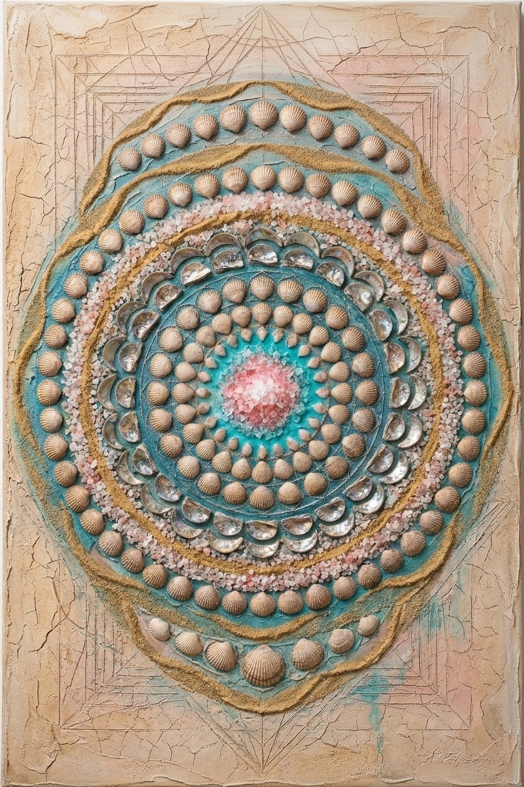
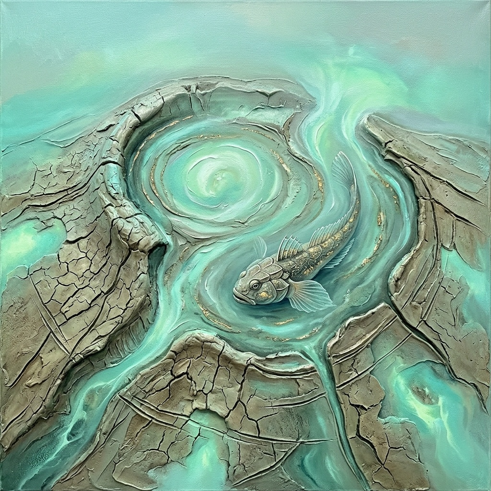
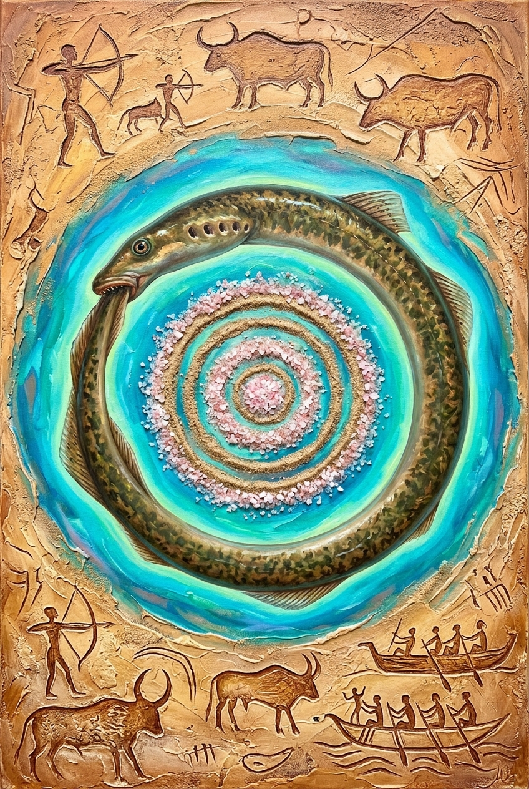
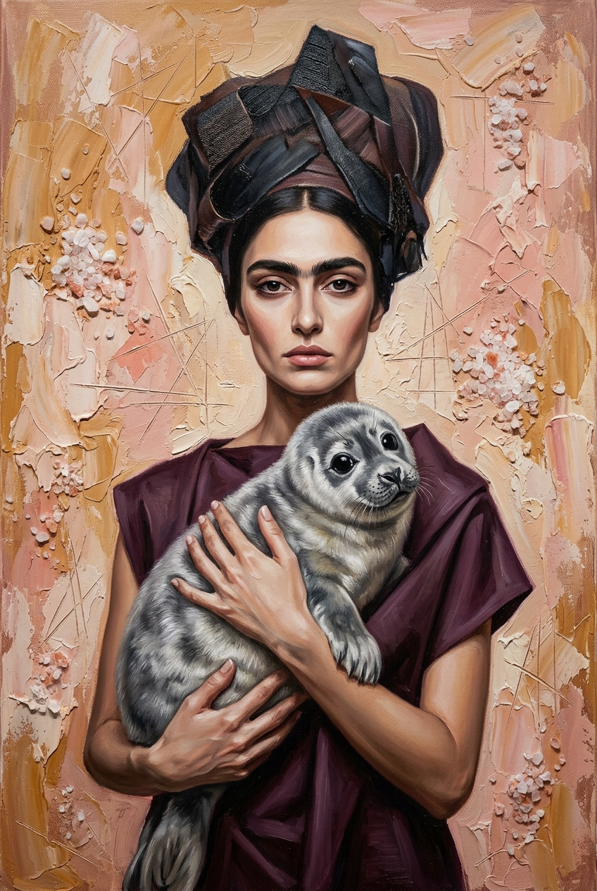

# Project Proposal
## Jeyran Mir-Gasim Jafarova

**Commissioning Body**: Gazelli Art House (London / Baku)  
**Submitting Artist**: Jeyran Mir-Gasim Jafarova (Baku, Azerbaijan)  
**Submission Status**: Submitted in Formal Response to the Curatorial Commission Selection Brief  
**Executive Master Dossier (PDF)**: [MIRGASIM_ART_GAZELLI_COMMISSION_DOSSIER.pdf](MIRGASIM_ART_GAZELLI_COMMISSION_DOSSIER.pdf)  
**Architectural In-Situ Visualizations**: [_insitu/](_insitu/)  
**Museum Archival Exhibition Plates**: [_exhibition_plates/](_exhibition_plates/)  
**Clean Production Masters**: [_clean/](_clean/)  
**Protected Distribution Copies**: [_watermarked/](_watermarked/)  

---

## I. Executive Curatorial Statement & Heritage Lineage

Responding to the international architectural and curatorial standards of **Gazelli Art House**, this collection explores the raw geological signatures of the Absheron Peninsula and the fragile endemism of the Caspian Sea.

Rather than submitting disconnected decorative canvases, the artist has developed an **interlocking 5-movement geological suite**. Each piece channels the pioneering spirit of the **Absheron Modernist School**—following masters like **Javad Mirjavadov, Sattar Bahlulzade, Rasim Babayev, and Tofig Javadov**—who broke from Soviet Socialist Realism by drawing directly from the wind-beaten terrain, subterranean fires, and mythic spirit of Absheron.

### The 21st-Century Evolutionary Principles:
1. **The Literal Substances of the Land**:
   Conventional decorative paint is replaced with the physical geological matter of Absheron: raw crystalline lake salt from Masazir, subterranean clay ejecta from Lokbatan mud volcanoes, unrefined Binagadi bitumen, brassy pyrite ore, and coastal coquina limestone.
2. **Strictly Skip Carpets**:
   Superficial textile repetition, carpet borders, and kilim motifs are **entirely excluded**. The visual vocabulary is rooted strictly in daş yonma (monumental stone carving), Shebeke architectural stone tracery, Gobustan petroglyphs, and Caspian scientific taxonomy.
3. **The 3:2 Curatorial Straddle**:
   The suite balances **3 Atmospheric Sanctuary Works** (organic serenity, saline craquelure, and calm marine life suited for wellness and VIP suites) with **2 Monumental Horizon Works** (architectural scaffolding, eternal subterranean fire, and mythic rock art suited for grand double-height lobbies and reception spaces).

### Curatorial Taxonomy & Caspian Endemism Strategy:
The faunal motifs across this suite deliberately privilege **archaic benthic organisms and geological survivors** (*Didacna* fossil bivalves, *Alosa braschnikowi* marine shad, *Benthophilus* armored tadpole goby, and *Caspiomyzon wagneri* prehistoric lamprey) to symbolize deep evolutionary time, subterranean geothermal currents, and primordial geological antiquity. While the **Caspian Seal (*Pusa caspica*)** represents the iconic modern pelagic sentinel of the Caspian basin, it is honored here through its lacustrine and shoreline sanctuaries (with an authorial figurative study—*The Muse of Masazir: Pusa caspica*—documented in the atelier archive as an available companion acquisition for dedicated wellness environments).

---


### Plate 01: *Luminescence of Masazir Dawn*
*Masazır Şəfəqi: Çəhrayı Duz Gölü*


> **Museum Archival Edition**: [View Mounted Exhibition Passe-Partout Plate](_exhibition_plates/plate_01_luminescence_of_masazir_salt_dawn.jpg)  
> **Architectural In-Situ Simulation**: [View Installed in Executive Salon](_insitu/insitu_plate_01_masazir_dawn.jpg)

- **Genre**: Pure Mineral Abstraction / Lacustrine Strata Painting
- **Dimensions**: **185 × 120 cm** (Horizontal Landscape Canvas, Specification from Brief)
- **Target Spatial Placement**: Executive Boardroom, Presidential Suite, or Coastal Wellness Reception
- **Endemic Caspian Focus**: Absheron Lacustrine Strata (*Pure geological meditation; zero figures, zero fauna, zero carpets*)
- **Selected Absheron Minerals**:
  - **Masazir Pink Lake Salt**: Genuine crystalline lake salt encrustations integrated directly into the heavy impasto ground, catching natural daylight with subtle prismatic sparkle.
  - **Absheron Limestone & Alabaster Plaster**: Porous cream-and-ochre ground scored with delicate geometric sgraffito lines.
- **Curatorial Narrative**:
  An ethereal, meditative abstract landscape capturing the tranquil morning horizon over Lake Masazir. Where misted pastel-pink saline waters meet white crystalline shores, thick palette-knife impasto sculpts the organic coastline, embedded with coarse pink-and-white mineral crystals that glisten naturally in ambient light. Scored with delicate geometric sgraffito fissures in the mineral foreground, this composition embodies pure lacustrine serenity.
- **Turnkey Specifications**:
  - *Edge Treatment*: Continuous mineral gallery-wrap (unframed) or optional 10mm recessed matte dark walnut shadow-line floater frame.
  - *Chassis & Weight*: Cross-braced Finnish pine with aluminum cradle; estimated weight ~14.5 kg.
  - *Mounting Hardware*: Dual continuous aluminum French cleats (Z-bars) for flush high-traffic stability.
  - *Lighting Recommendation*: 2700K warm-white recessed ceiling wash lighting (CRI 95+).

---

### Plate 02: *The Shebeke Reliquary: Fossil Didacna in Absheron Stone*
*Şəbəkə Qalığı: Qədim Didakna və Daş Pəncərə*


> **Museum Archival Edition**: [View Mounted Exhibition Passe-Partout Plate](_exhibition_plates/plate_02_the_weaver_of_sunken_shells_didacna.jpg)  
> **Architectural In-Situ Simulation**: [View Installed in Corridor Alcove](_insitu/insitu_plate_02_shebeke_reliquary.jpg)

- **Genre**: Mixed-Media Painting on Canvas / Tactile Stone Relief
- **Dimensions**: **40 × 60 cm** (Vertical Architectural Canvas, Specification from Brief)
- **Target Spatial Placement**: VIP Elevator Vestibule, Intimate Gallery Corridor, or Private Dining Alcove
- **Endemic Caspian Organism**: Caspian Cockles (*Didacna trigonoides* & *Didacna pyramidata*)
- **Selected Absheron Minerals**:
  - **Absheron Limestone & Coquina Primer**: Fine quarry coquina and porous limestone powder integrated into the gesso ground for authentic masonry tooth.
  - **Absheron Coastal Beach Sand**: Natural quartz-shell sand blended into knife impasto.
  - **Subtle Natural Caspian Didacna Accents**: Genuine small Didacna bivalve shells embedded in low-relief into the impasto crust.
- **Curatorial Narrative**:
  Celebrating Absheron's ancient stone-carving heritage (*daş yonma*), this intimate vertical painting on canvas captures a weather-worn Shebeke window lattice rendered in thick palette-knife impasto and porous mineral grounds. Behind the painted geometric tracery glow luminous glazes of Caspian turquoise and deep lapis lazuli. The painted surface is enriched with subtle low-relief physical accents—authentic small Didacna cockle shells embedded into the impasto crust—while an elongated painted hand rests against the window aperture, bridging human craftsmanship and deep geological time.
- **Turnkey Specifications**:
  - *Edge Treatment*: Gallery-wrapped coquina primer edges or minimal blackened steel floater frame.
  - *Chassis & Weight*: Solid reinforced wood cradle; estimated weight ~3.2 kg.
  - *Mounting Hardware*: Single aluminum Z-bar cleat with locking pin.
  - *Lighting Recommendation*: 2700K–3000K accent spotlight with narrow 15° beam.

---

### Plate 03: *The Binagadi Derrick: Hydrocarbon Strata & Pyrite Shad*
*Binaqədi Buruğu: Qara Qızıl və Pirit Şad*


> **Museum Archival Edition**: [View Mounted Exhibition Passe-Partout Plate](_exhibition_plates/plate_03_keeper_of_the_cold_depths_caspian_shad.jpg)  
> **Architectural In-Situ Simulation**: [View Installed in Double-Height Lobby](_insitu/insitu_plate_03_binagadi_derrick.jpg)

- **Genre**: Industrial-Geological Abstraction / Hydrocarbon Matter Painting
- **Dimensions**: **80 × 100 cm** (Vertical Canvas, Specification from Brief)
- **Target Spatial Placement**: High-Traffic Transition Corridor, Executive Focal Wall, or Aviation VIP Lounge
- **Endemic Caspian Wildlife**: Caspian Marine Shad / Brazhnikov’s Shad (*Alosa braschnikowi*)
- **Selected Absheron Minerals**:
  - **Natural Absheron Bitumen (Binagadi & Fatmai deposits)**: Pure unrefined asphaltite applied in thick, viscous knife-strokes.
  - **Pyrite Mineral Aggregates**: Irregular metallic brassy-gold sulfide crystals embedded into the fish scales.
  - **Absheron Limestone Powder**: Providing chalky white contrast against the black bitumen.
- **Curatorial Narrative**:
  Confronting Baku's historic role as the pioneer of world petroleum, minimal structural scaffolding beams inspired by historic wooden oil derricks slice across visceral slabs of pitch-black Binagadi bitumen. Leaping through the dark matrix is an armored Caspian marine shad adorned with metallic golden pyrite ore, set above the eternal subterranean gas flame (*Yanar Dağ / Ateshgah*).
- **Turnkey Specifications**:
  - *Edge Treatment*: Polymerized bitumen continuous edge or dark oxidized bronze floater frame.
  - *Chassis & Weight*: Solid cross-braced Finnish pine chassis with aluminum cradle; estimated weight ~6.8 kg.
  - *Mounting Hardware*: Heavy-duty aircraft-grade aluminum French cleat (Z-bar).
  - *Lighting Recommendation*: 3000K museum track lighting to catch pyrite metallic facets.

---

### Plate 04: *Breath of Lokbatan: Volcanic Crater and Armored Goby*
*Lökbatan Nəfəsi: Palçıq Vulkanı və Zirehli Qobi*


> **Museum Archival Edition**: [View Mounted Exhibition Passe-Partout Plate](_exhibition_plates/plate_04_breath_of_lokbatan_tadpole_goby.jpg)  
> **Architectural In-Situ Simulation**: [View Installed in Grand Salon](_insitu/insitu_plate_04_breath_of_lokbatan.jpg)

- **Genre**: Earth-Art Vortex / Geothermal Mineral Painting
- **Dimensions**: **180 × 180 cm** (Monumental 1:1 Square Canvas, Specification from Brief)
- **Target Spatial Placement**: Grand Central Atrium, Double-Height Salon, or Wellness Mezzanine Feature Wall
- **Endemic Caspian Wildlife**: Armored Caspian Tadpole Goby (*Benthophilus* spp.)
- **Selected Absheron Minerals**:
  - **Subterranean Lokbatan Mud-Volcano Clay**: Authentic mineral clay curing into dynamic 3D craquelure fissures.
  - **Caspian Mineral Glazes**: Luminous celadon, seafoam green, and verdigris pigments evoking thermal spring luminescence.
  - **Metallic Pyrite Infiltration**: Genuine pyrite mineral grains accenting the prehistoric armor plates of the goby.
  - **Incised Sgraffito Lines**: Deep directional fissures carved into the wet clay bed.
- **Curatorial Narrative**:
  A monumental square statement uniting subterranean geothermal energy with aquatic serenity. An aerial vortex of an active mud-volcano crater rendered in thick palette-knife impasto and authentic mud clay craquelure fissures opens into luminous, flowing glazes of Caspian celadon and seafoam green. Gliding through the geothermal currents, an armored Caspian tadpole goby (*Benthophilus*) gleams with metallic pyrite veins, harmonizing primordial geological power with tranquil ecological resilience.
- **Turnkey Specifications**:
  - *Edge Treatment*: Continuous volcanic craquelure wrap or custom recessed matte black floater frame.
  - *Chassis & Weight*: Dual-aluminum cross-braced cradled chassis; estimated weight ~19.5 kg.
  - *Mounting Hardware*: Triple heavy-duty aircraft-grade aluminum French cleats.
  - *Lighting Recommendation*: High-CRI (98) wall wash lighting grazing from above to accent deep craquelure shadows.

---

### Plate 05: *The Gobustan Solar Oracle: Ouroboros Lamprey*
*Qobustan Günəşi: İlanbalığı və Qədim Qaya Təsvirləri*


> **Museum Archival Edition**: [View Mounted Exhibition Passe-Partout Plate](_exhibition_plates/plate_05_the_lampreys_vigil_caspian_lamprey.jpg)  
> **Architectural In-Situ Simulation**: [View Installed in Ceremonial Vestibule](_insitu/insitu_plate_05_gobustan_oracle.jpg)

- **Genre**: Mythological Contemporary Altar Piece / Archaeological Totem
- **Dimensions**: **120 × 100 cm** (Horizontal Canvas, Specification from Brief)
- **Target Spatial Placement**: Ceremonial Foyer, Executive Reception, or Gallery Altar Niche
- **Endemic Caspian Wildlife**: Caspian Lamprey (*Caspiomyzon wagneri*)
- **Selected Absheron Minerals**:
  - **Absheron Coastal Beach Sand**: Concentric rings textured with raw beach sand.
  - **Masazir Lake Salt Crystals**: Saline clusters embedded along the cyan-blue outer orbital halo.
  - **Absheron Limestone & Bone Plaster**: Sgraffito incisions depicting Gobustan rock petroglyphs.
- **Curatorial Narrative**:
  A transcendental contemporary altar piece uniting prehistoric rock art with ecological mystery. The ancient Caspian lamprey coils into an Ouroboros circle of eternity around a concentric sand-and-salt mandala. Carved directly into the limestone ground are Gobustan petroglyphs (reed boats, hunters, and sacred solar bulls), immortalizing Absheron's ancient rock art heritage within deep cosmological time.
- **Turnkey Specifications**:
  - *Edge Treatment*: Mineral-plaster gallery edge or dark oiled walnut floater frame.
  - *Chassis & Weight*: Anti-warp aluminum-cradled stretcher; estimated weight ~8.2 kg.
  - *Mounting Hardware*: Dual aluminum Z-bar cleat set.
  - *Lighting Recommendation*: Dedicated 2700K framing projector or adjustable gimbal spotlight.

---

### Atelier Companion Study: *The Muse of Masazir (Caspian Seal)*
*Masazır Pərisi: Xəzər Suiti və Duz Qayası*


> **Atelier Archive Reference**: [Full Archival Study](_studies/the_muse_of_masazir_caspian_seal_study.jpg)

- **Genre**: Figurative Mineral Portraiture / Geological Matter Painting
- **Dimensions**: **100 × 150 cm** (Vertical Portrait Canvas, Specification from Brief)
- **Target Spatial Placement**: Private VIP Wellness Suite, Executive Lounge, or Presidential Antechamber
- **Endemic Caspian Wildlife**: Caspian Seal (*Pusa caspica*)
- **Selected Absheron Minerals**: Genuine Masazir pink lake salt encrustations, porous Absheron limestone plaster ground, delicate geometric sgraffito incisions.
- **Curatorial Narrative**:
  Synthesizing Mirgasim’s iconic visual hallmarks—a melancholic, statuesque Azerbaijani muse with connected dark brows, sculpted hands, and intense gaze—with the raw geological matter of Absheron. Cradled tenderly in her arms is a gentle Caspian seal pup (*Pusa caspica*), its silver-grey mottled coat glistening against modern draped plum-burgundy fabric. The background is a thick, sculptural palette-knife impasto ground in warm ochres and blush tones, embedded with authentic sparkling crystalline clusters of raw pink-and-white Masazir lake salt and incised with delicate geometric sgraffito lines. Zero textiles, zero carpets; pure authorial painterly mastery.
- **Turnkey Specifications**:
  - *Edge Treatment*: Gallery-wrapped blush limestone edges or dark American walnut floater frame.
  - *Chassis & Weight*: Aluminum-reinforced cross-braced stretcher; estimated weight ~11.0 kg.
  - *Mounting Hardware*: Dual aluminum Z-bar cleat set.
  - *Lighting Recommendation*: Warm 2700K soft wash lighting grazing down the crystalline salt background.

---

## III. Archival Conservation & Chemical Stability Protocol

To satisfy commercial facilities managers and museum registrars, all raw geological matter is stabilized under strict archival standards:

1. **Masazir Salt Crystal Stabilization**:
   Raw halite crystals from Lake Masazir undergo thermal dehydration before being encapsulated in non-yellowing, UV-filtering matte acrylic resin. This shields the crystals from ambient relative humidity (RH 30%–75%), completely preventing deliquescence or saline weeping.
2. **Mud-Volcano Clay & Craquelure Binding**:
   Subterranean Lokbatan clay is co-polymerized with pure elastomeric dispersion binders. As the clay dries and forms natural geological craquelure, the matrix remains permanently flexible, preventing flaking, chipping, or particulate shedding over time.
3. **Binagadi Bitumen Polymerization**:
   Natural asphaltite is dissolved into an archival mineral spirit vehicle and cold-polymerized with UV-stable synthetic varnishes. This eliminates aromatic hydrocarbon evaporation (zero odor/VOC off-gassing) and ensures the bitumen remains solid up to 65°C under direct gallery accent lighting.
4. **Structural Substrates & Dimensional Integrity**:
   Canvases are stretched over custom-fabricated, kiln-dried Finnish pine and cross-braced aluminum-cradled panels, guaranteeing absolute planar stability without sagging or warping across seasonal interior humidity shifts.

---

## IV. Turnkey Architectural Specifications & Contractor Integration

As an individual fine artist delivering bespoke masterworks for prime architectural placements, Jeyran Mir-Gasim Jafarova supplies completely resolved, turnkey-ready canvases engineered for immediate contractor installation:

```
┌─────────────────────────────────────────────────────────────────────────────────────────────────────────────────┐
│                               TURNKEY ARCHITECTURAL INSTALLATION SPECIFICATIONS                                 │
├──────┬──────────────┬─────────────┬───────────────────────────┬──────────────────────────┬──────────────────────┤
│ NO.  │ DIMENSIONS   │ EST. WEIGHT │ EDGE / FRAMING PROFILE    │ RIGGING HARDWARE         │ OPTIMAL LIGHTING     │
├──────┼──────────────┼─────────────┼───────────────────────────┼──────────────────────────┼──────────────────────┤
│ 01   │ 185 × 120 cm │ ~14.5 kg    │ Continuous Mineral Wrap   │ Dual Aluminum Z-Cleats   │ 2700K Ceiling Wash   │
│      │ Horizontal   │             │ (Optional Dark Walnut)    │ (Flush Wall Attachment)  │ (CRI 95+)            │
├──────┼──────────────┼─────────────┼───────────────────────────┼──────────────────────────┼──────────────────────┤
│ 02   │ 40 × 60 cm   │ ~3.2 kg     │ Gallery Limestone Gesso   │ Single Aluminum Cleat    │ 2700K–3000K Spot     │
│      │ Vertical     │             │ (Optional Black Steel)    │ With Locking Pin         │ (15° Beam Angle)     │
├──────┼──────────────┼─────────────┼───────────────────────────┼──────────────────────────┼──────────────────────┤
│ 03   │ 80 × 100 cm  │ ~6.8 kg     │ Bitumen Polymer Edge Wrap │ Heavy-Duty Aluminum Cleat│ 3000K Track Flood    │
│      │ Vertical     │             │ (Optional Oxidized Bronze)│ Rated to 50 kg           │ (Highlight Pyrite)   │
├──────┼──────────────┼─────────────┼───────────────────────────┼──────────────────────────┼──────────────────────┤
│ 04   │ 180 × 180 cm │ ~19.5 kg    │ Deep Clay Craquelure Wrap │ Triple Aluminum Cleats   │ High-CRI 98 Wash     │
│      │ Square 1:1   │             │ (Optional Blackened Wood) │ Seismic Rated Rigging    │ (Grazing Texture)    │
├──────┼──────────────┼─────────────┼───────────────────────────┼──────────────────────────┼──────────────────────┤
│ 05   │ 120 × 100 cm │ ~8.2 kg     │ Bone Plaster Gallery Wrap │ Dual Aluminum Z-Cleats   │ 2700K Framing        │
│      │ Horizontal   │             │ (Optional Oiled Walnut)   │ Micro-Adjustable Level   │ Projector / Gimbal   │
└──────┴──────────────┴─────────────┴───────────────────────────┴──────────────────────────┴──────────────────────┘
```

---

## V. Curatorial Material Palette Box ("The Tactile Verification")

Because the essence of the Absheron School lineage resides in the physical materiality of the terrain, Jeyran Mir-Gasim Jafarova offers to provide the selection panel with a bespoke **Curatorial Material Palette Box**.

This presentation box contains five cured, non-toxic **15 × 15 cm architectural plaques** representing the exact tactile formulations of each artwork:
1. **Crystalline Masazir Halite**: Oven-dehydrated lake salt embedded in matte UV-protective acrylic.
2. **Lokbatan Volcanic Craquelure**: Subterranean mud clay co-polymerized for zero flaking or particulate dusting.
3. **Binagadi Bitumen Glaze**: Cold-polymerized asphaltite with zero VOC emission.
4. **Honed Absheron Coquina**: Porous local shell limestone ground for tactile tooth.
5. **Pyrite Sulfide Ore Aggregates**: Natural brassy mineral crystals set in mineral gesso.

*Available upon request for physical examination during curatorial committee review.*

---

## VI. Atelier Distribution Deliverables

1. **Executive Master PDF Dossier**:
   - [`MIRGASIM_ART_GAZELLI_COMMISSION_DOSSIER.pdf`](MIRGASIM_ART_GAZELLI_COMMISSION_DOSSIER.pdf) (Complete multi-page high-definition presentation).
2. **Architectural In-Situ Visualizations**:
   - [`_insitu/`](_insitu/) — Photorealistic renders of each work installed within luxury architectural interiors.
3. **Museum Archival Exhibition Plates**:
   - [`_exhibition_plates/`](_exhibition_plates/) — Full-bleed gallery passe-partout editions formatted for auction catalogues and executive review.
4. **Clean Unwatermarked Production Masters**:
   - [`_clean/`](_clean/) — Preserved in pristine archival master resolution for architectural rendering and printing.
5. **Protected Digital Client Copies**:
   - [`_watermarked/`](_watermarked/) — Embedded with the obsidian-and-gold studio wordmark.

---

**JEYRAN MIR-GASIM JAFAROVA**  
Baku, Azerbaijan  
*Submitted in Formal Response to the Curatorial Commission Selection Brief | Gazelli Art House (London / Baku)*  

<small>*All visual concepts, chemical formulations, and curatorial narratives © 2026 Jeyran Mir-Gasim Jafarova. All rights reserved.*</small>
