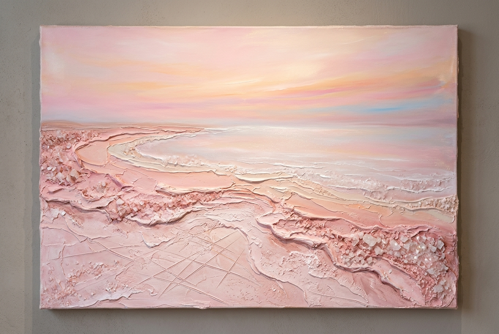

# MIRGASIM ART™ | Curatorial Commission Proposal & Artist Dossier
## *Absheron Tectonics: Primordial Matter & Geological Strata*

**Commissioning Body**: Gazelli Art House (London / Baku)  
**Representing Atelier**: Mirgasim Art Studio (Baku, Azerbaijan)  
**Executive Master Dossier (PDF)**: [MIRGASIM_ART_GAZELLI_COMMISSION_DOSSIER.pdf](MIRGASIM_ART_GAZELLI_COMMISSION_DOSSIER.pdf) (6-Page Presentation with Running Headers, Footers, Page Numbers, and Studio Trademarks)  
**Copyright & Trademark Notice**: MIRGASIM ART™ is a registered trademark of Mirgasim Art Studio. All concepts, visual plates, material chemistries, and curatorial narratives are protected under international copyright law. © 2026 Mirgasim Art Studio. All rights reserved.

---

### Curatorial Statement & Vision
Responding to the highest standards of contemporary fine art at **Gazelli Art House**, this collection explores authentic Absheron signatures and Caspian endemism through the physical substances of the land:
- **Saline Strata of Masazir: Crystalline Lakebed Abstraction** (Lake Masazir Pink Salt, Mineral Terraces & Sgraffito)
- **Shebeke Window Tracery & Paleontological Strata** (Absheron Limestone Ground, Sand Texture & Subtle Didacna Shell Accents)
- **Industrial Hydrocarbon Scaffolding & Eternal Flames** (Binagadi Bitumen, Historic Derricks, Pyrite Ore & Marine Shad)
- **Breath of Lokbatan: Volcanic Crater and Armored Goby** (Subterranean Mud-Volcano Clay, Luminous Celadon Glazes & Pyrite Veins)
- **The Gobustan Petroglyphic Solar Oracle** (Ouroboros Lamprey, Beach Sand Mandala & Incised Rock Petroglyphs)

Preserving the raw textural DNA of the Absheron School—heavy sculptural palette-knife impasto, tactile mineral reliefs, authentic crystalline encrustations, and deep incised sgraffito fissures—this exhibition replaces superficial decorative clichés with the literal primordial matter of the Absheron Peninsula.

---

## Modular Copyright Protection & Wordmark System

To protect studio copyright and provenance across digital and print distribution:
- **Protected Client & Press Distribution Copies**: High-resolution artworks featuring the modular **MIRGASIM ART™** wordmark badge are generated in [`watermarked/`](watermarked/) (and [`docs/output/watermarked/`](../watermarked/)).
- **Unwatermarked Archival Masters**: Master unwatermarked high-resolution plates remain preserved in [`latest/`](.) for gallery production.
- **Automation Scripts**:
  - `python3 scripts/watermark_artworks.py` — Re-applies/toggles the modular wordmark across all master works and study variations.
  - `python3 scripts/build_proposal_dossier.py` — Re-compiles the 10-page luxury PDF dossier with running headers, footers, and page numbers.

---

## Catalog of Artworks

### 1. *Luminescence of Masazir Dawn* (*Masazır Şəfəqi: Çəhrayı Duz Gölu*)

- **Genre**: Pure Mineral Abstraction / Geological Earth Painting
- **Dimensions**: 185 × 120 cm (Horizontal Landscape Canvas, Specification from Brief)
- **Endemic Caspian Focus**: Absheron Lacustrine Strata & Lake Masazir Minerals
- **Selected Absheron Materials**:
  - **Masazir Pink Lake Salt**: Genuine crystalline pink-and-white salt encrustations integrated directly into the heavy impasto ground.
  - **Absheron Limestone & Alabaster Plaster**: Porous cream-and-ochre ground scored with delicate geometric sgraffito lines.
- **Curatorial Narrative**:
  An ethereal, meditative abstract landscape capturing the tranquil morning horizon over Lake Masazir. Where misted pastel-pink saline waters meet white crystalline shores, thick palette-knife impasto sculpts the organic coastline, embedded with coarse pink-and-white mineral crystals that glisten naturally in ambient light. Scored with delicate geometric sgraffito fissures in the mineral foreground, this composition embodies pure lacustrine serenity. *(Pure geological abstraction; zero portraits, zero figures, zero seals, zero carpets).*

---

### 2. *The Shebeke Reliquary: Fossil Didacna in Absheron Stone* (*Şəbəkə Qalığı: Qədim Didakna və Daş Pəncərə*)

- **Genre**: Mixed-Media Painting on Canvas / Tactile Mineral Impasto
- **Dimensions**: 40 × 60 cm (Vertical Format Canvas, Specification from Brief)
- **Endemic Caspian Organism**: Caspian Cockle (*Didacna trigonoides* / *Didacna pyramidata*)
- **Selected Absheron Materials**:
  - **Absheron Limestone & Coquina Primer**: Fine quarry coquina and porous limestone powder integrated into the gesso ground for authentic mineral tooth.
  - **Absheron Coastal Sand**: Natural coastal sand blended into palette-knife impasto.
  - **Subtle Natural Caspian Didacna Accents**: Small, genuine Didacna bivalve shells delicately embedded into the impasto surface for subtle tactile low-relief dimensionality.
- **Curatorial Narrative**:
  Celebrating Absheron's ancient stone-carving heritage (*daş yonma*), this intimate vertical painting on canvas captures a weather-worn Shebeke window lattice rendered in thick palette-knife impasto and porous mineral grounds. Behind the painted geometric tracery glow luminous glazes of Caspian turquoise and deep lapis lazuli. The painted surface is enriched with subtle low-relief physical accents—authentic small Didacna cockle shells embedded into the impasto crust—while an elongated painted hand rests against the window aperture, bridging human craftsmanship and deep geological time. *(Mixed-media painting on canvas; subtle tactile low-relief elements; no freestanding or wall sculptures, no carpets).*

---

### 3. *The Binagadi Derrick: Hydrocarbon Strata & Pyrite Shad* (*Binaqədi Buruğu: Qara Qızıl və Pirit Şad*)

- **Genre**: Industrial-Geological Abstraction / Hydrocarbon Matter Painting
- **Dimensions**: 120 × 200 cm (Vertical Panoramic Canvas, Specification from Brief)
- **Endemic Caspian Wildlife**: Caspian Marine Shad / Brazhnikov’s Shad (*Alosa braschnikowi*)
- **Selected Absheron Materials**:
  - **Natural Absheron Bitumen (Binagadi & Fatmai deposits)**: Pure unrefined asphaltite applied in thick, viscous knife-strokes.
  - **Pyrite Mineral Aggregates**: Irregular metallic brassy-gold sulfide crystals embedded into the fish scales.
  - **Absheron Limestone Powder**: Providing stark, chalky white contrast against the black bitumen.
- **Curatorial Narrative**:
  Engaging directly with Baku’s historic role as the pioneer of world petroleum, this dynamic piece juxtaposes sharp, minimalist scaffolding beams inspired by historic wooden oil derricks against slabs of pitch-black bitumen. Leaping through the dark structural lines is a Caspian marine shad adorned with shimmering pyrite ore, above an eternal natural gas flame (*Yanar Dağ / Ateshgah*) burning in the foreground. *(No carpets; industrial heritage meeting abyssal marine life).*

---

### 4. *Breath of Lokbatan: Volcanic Crater and Armored Goby* (*Lökbatan Nəfəsi: Palçıq Vulkanı və Zirehli Qobi*)

- **Genre**: Earth-Art Vortex / Geothermal Mineral Painting
- **Dimensions**: 180 × 180 cm (Monumental Square Canvas, Specification from Brief)
- **Endemic Caspian Wildlife**: Armored Caspian Tadpole Goby (*Benthophilus* spp.)
- **Selected Absheron Materials**:
  - **Subterranean Lokbatan Mud-Volcano Clay**: Authentic mineral clay curing into dynamic 3D craquelure fissures.
  - **Caspian Mineral Glazes**: Luminous celadon, seafoam green, and verdigris pigments evoking thermal spring luminescence.
  - **Metallic Pyrite Infiltration**: Genuine pyrite mineral grains accenting the prehistoric armor plates of the goby.
  - **Incised Sgraffito Lines**: Deep directional fissures carved into the wet clay bed.
- **Curatorial Narrative**:
  A monumental square statement uniting subterranean geothermal energy with aquatic serenity. An aerial vortex of an active mud-volcano crater rendered in thick palette-knife impasto and authentic mud clay craquelure fissures opens into luminous, flowing glazes of Caspian celadon and seafoam green. Gliding through the geothermal currents, an armored Caspian tadpole goby (*Benthophilus*) gleams with metallic pyrite veins, harmonizing primordial geological power with tranquil ecological resilience. *(Zero carpets, pure geological matter, mineral craquelure, and authentic Caspian endemism).*

---

### 5. *The Gobustan Solar Oracle: Ouroboros Lamprey* (*Qobustan Günəşi: İlanbalığı və Qədim Qaya Təsvirləri*)

- **Genre**: Mythological Totemic Icon / Contemporary Symbolist Altar Piece
- **Dimensions**: 100 × 150 cm (Portrait Specification from Brief)
- **Endemic Caspian Wildlife**: Caspian Lamprey (*Caspiomyzon wagneri*)
- **Selected Absheron Materials**:
  - **Absheron Coastal Beach Sand**: Concentric rings textured with raw beach sand.
  - **Masazir Lake Salt Crystals**: Saline clusters embedded along the cyan-blue outer orbital halo.
  - **Absheron Limestone & Bone Plaster**: Sgraffito incisions depicting Gobustan rock petroglyphs.
- **Curatorial Narrative**:
  A transcendental contemporary altar piece uniting prehistoric rock art with ecological mystery. The ancient Caspian lamprey coils into an Ouroboros circle of eternity around a concentric sand-and-salt mandala. Carved directly into the limestone ground are Gobustan petroglyphs (reed boats, hunters, and sacred solar bulls), immortalizing Absheron's ancient rock art heritage within deep cosmological time. *(No carpets; pure stone petroglyphs, sand mandala, and primordial marine life).*

---

## Technical Integration & Absheron Materiality

1. **Mineral Priming**:
   Canvases are grounded with an authentic limestone-and-coquina primer replicating the porous masonry of Baku.
2. **True Craquelure & Salt Accents**:
   Mud-volcano clay and Masazir salt crystals cure naturally on the support, producing authentic 3D tactile relief.
3. **Hydrocarbon & Pyrite Glazing**:
   Authentic bitumen from Absheron seepages provides deep, velvety black fields, while raw pyrite ore catches light with metallic specular highlights.
4. **Restraint & Conceptual Diversity**:
   Moving beyond repetitive decorative motifs to celebrate Absheron’s stone architecture, petroleum history, salt lakes, mud volcanoes, and ancient petroglyphs.
