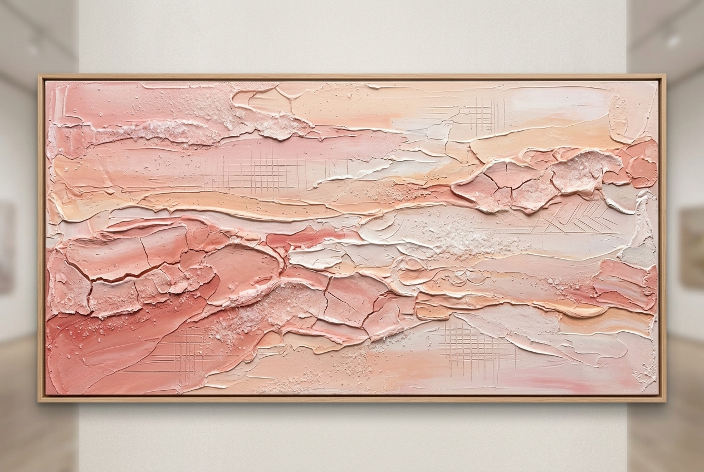
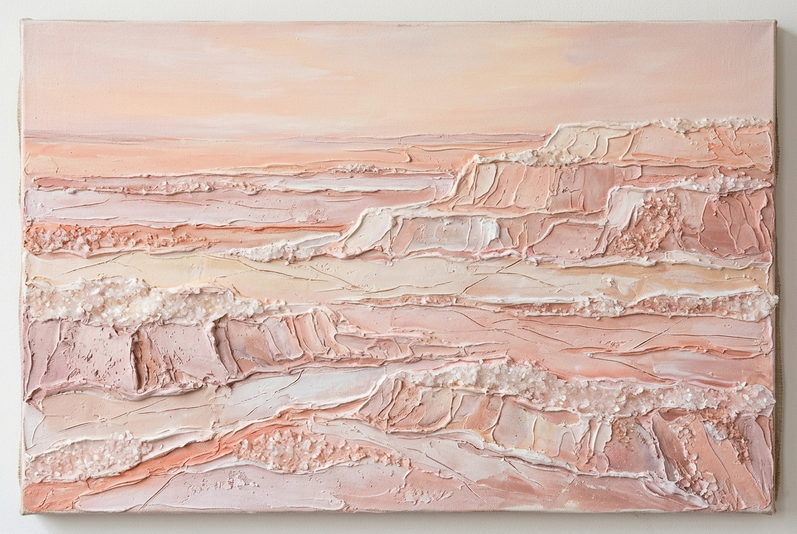
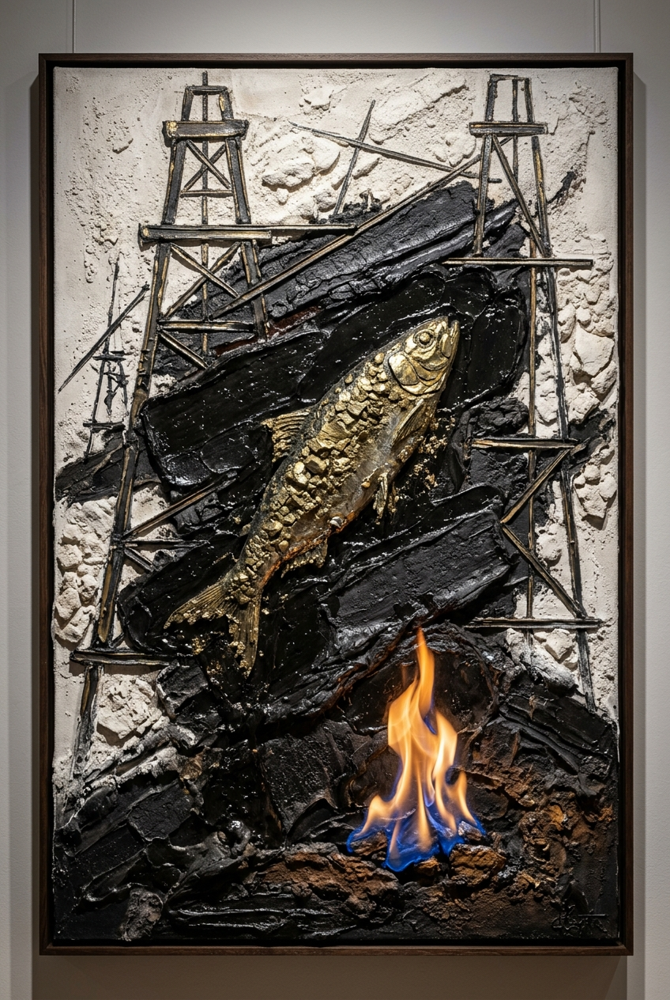
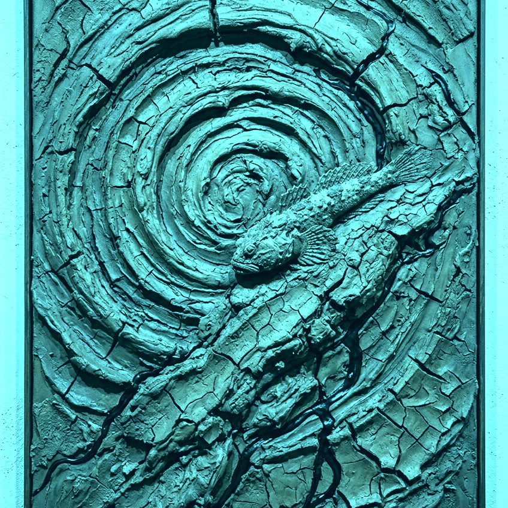
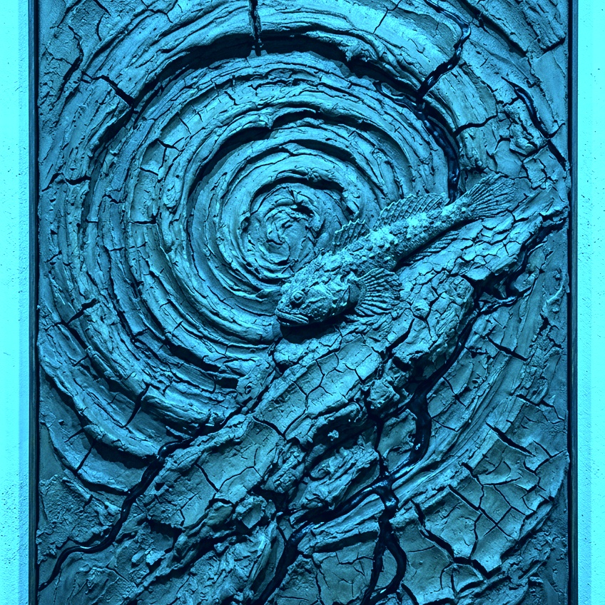
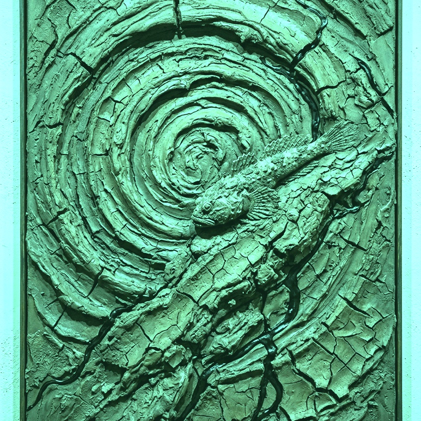
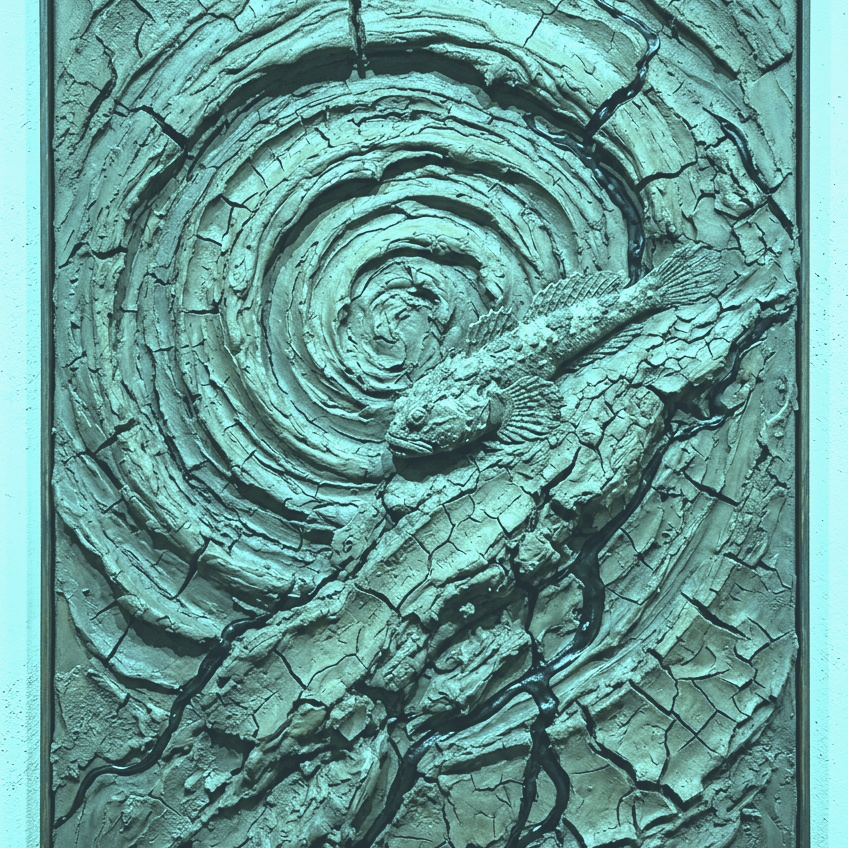
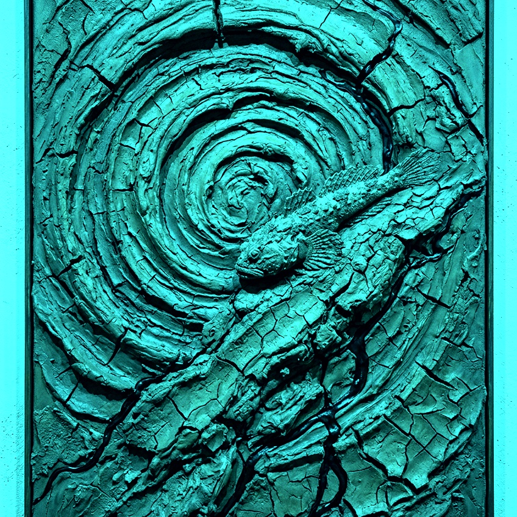

# Gazelli Art House Exhibition Proposal (Latest Active Version)
## *Absheron Tectonics: Primordial Matter & Geological Strata*

### Curatorial Statement & Vision
Responding to the highest standards of contemporary fine art at **Gazelli Art House**, this collection explores authentic Absheron signatures and Caspian endemism through the physical substances of the land:
- **Saline Strata of Masazir: Crystalline Lakebed Abstraction** (Lake Masazir Pink Salt, Mineral Terraces & Sgraffito)
- **Carved Stone Shebeke Tracery & Paleontological Strata** (Absheron Limestone, Coquina & Fossil Didacna)
- **Industrial Hydrocarbon Scaffolding & Eternal Flames** (Binagadi Bitumen, Historic Derricks, Pyrite Ore & Marine Shad)
- **The Celadon Caldera: Volcanic Craquelure & Armored Goby** (Lokbatan Clay, Greenish-Blue Caspian Verdigris Glazes, Pyrite Ore & Caspian Goby, Square 1:1 Format)
- **The Gobustan Petroglyphic Solar Oracle** (Ouroboros Lamprey, Beach Sand Mandala & Incised Rock Petroglyphs)

Preserving the raw textural DNA of the Absheron School—heavy sculptural palette-knife impasto, tactile mineral reliefs, authentic crystalline encrustations, and deep incised sgraffito fissures—this exhibition replaces superficial decorative clichés with the literal primordial matter of the Absheron Peninsula.

---

## Catalog of Artworks

### 1. *Strata of Masazir: Crystalline Salt Landscape* (*Masazır Layları: Çəhrayı Duz Abstraksiyası*)

- **Genre**: Pure Mineral Abstraction / Geological Earth Painting
- **Dimensions**: 185 × 120 cm (Horizontal Landscape Canvas, Specification from Brief)
- **Endemic Caspian Focus**: Absheron Lacustrine Strata & Lake Masazir Minerals
- **Selected Absheron Materials**:
  - **Masazir Pink Lake Salt**: Genuine crystalline pink-and-white salt encrustations integrated directly into the heavy impasto ground.
  - **Absheron Limestone & Alabaster Plaster**: Porous cream-and-ochre ground scored with razor-thin geometric sgraffito lines.
- **Curatorial Narrative**:
  A serene, meditative abstract landscape composed of authentic crystalline pink-and-white salt encrustations from Lake Masazir. Honoring the mineral earth-art lineage of the Absheron School, the composition unfolds in sweeping horizontal terraces of soft rose-quartz, blush pink, peach, and warm alabaster white. The thick, sculptural palette-knife impasto captures the tactile relief of evaporated saline beds, glistening naturally under ambient light and scored with delicate geometric sgraffito fissures. Completely non-figurative, tranquil, and evocative of deep lacustrine time. *(Pure geological abstraction; zero portraits, zero figures, zero seals, zero carpets).*

#### Additional Iteration Studies:
| Study B: *Crystalline Terraces* | Study C: *Luminescence of Masazir Dawn* |
| :---: | :---: |
|  |  |
| *Stepped saline terraces & crystalline ridge-lines* | *Atmospheric sunrise over misty salt shoreline* |

---

### 2. *The Shebeke Reliquary: Fossil Didacna in Absheron Stone* (*Şəbəkə Qalığı: Qədim Didakna və Daş Pəncərə*)

- **Genre**: Architectural Stone Frieze & Paleontological Matter Relief
- **Dimensions**: 150 × 200 cm (Vertical Monumental Canvas, Specification from Brief)
- **Endemic Caspian Organism**: Caspian Cockle (*Didacna trigonoides* / *Didacna pyramidata*)
- **Selected Absheron Materials**:
  - **Coquina (Shell Limestone)**: Heavy, porous quarry coquina forming the structural wall.
  - **Absheron Beach Sand**: Coastal sand mixed into the wet plaster relief.
  - **Natural Caspian Didacna Shells**: Genuine fossilized and contemporary Didacna bivalve shells protruding in high sculptural relief.
- **Curatorial Narrative**:
  Celebrating Absheron's ancient stone carving heritage (*daş yonma*), this monumental work depicts a coquina wall with an intricate geometric stone Shebeke window lattice. Behind the stone tracery glow luminous glazes of Caspian turquoise and deep lapis lazuli. Protruding from the limestone are radiant Didacna cockles, while a single elongated, sculpted hand touches the stone window frame, linking human craftsmanship with deep geological time. *(No carpets; pure architectural masonry & fossil relief).*

---

### 3. *The Binagadi Derrick: Hydrocarbon Strata & Pyrite Shad* (*Binaqədi Buruğu: Qara Qızıl və Pirit Şad*)

- **Genre**: Industrial-Geological Abstraction / Hydrocarbon Matter Painting
- **Dimensions**: 120 × 200 cm (Vertical Panoramic Canvas, Specification from Brief)
- **Endemic Caspian Wildlife**: Caspian Marine Shad / Brazhnikov’s Shad (*Alosa braschnikowi*)
- **Selected Absheron Materials**:
  - **Natural Absheron Bitumen (Binagadi & Fatmai deposits)**: Pure unrefined asphaltite applied in thick, viscous knife-strokes.
  - **Pyrite Mineral Aggregates**: Irregular metallic brassy-gold sulfide crystals embedded into the fish scales.
  - **Absheron Limestone Powder**: Providing stark, chalky white contrast against the black bitumen.
- **Curatorial Narrative**:
  Engaging directly with Baku’s historic role as the pioneer of world petroleum, this dynamic piece juxtaposes sharp, minimalist scaffolding beams inspired by historic wooden oil derricks against slabs of pitch-black bitumen. Leaping through the dark structural lines is a Caspian marine shad adorned with shimmering pyrite ore, above an eternal natural gas flame (*Yanar Dağ / Ateshgah*) burning in the foreground. *(No carpets; industrial heritage meeting abyssal marine life).*

---

### 4. *The Celadon Caldera: Breath of Lokbatan* (*Lökbatan Nəfəsi: Seladon Palçıq Qrifonu və Qobi*)

- **Genre**: Earth-Art Matter Painting & Tectonic Craquelure
- **Dimensions**: 180 × 180 cm (Square Format, Specification from Brief)
- **Endemic Caspian Wildlife**: Caspian Tadpole Goby (*Benthophilus* spp.)
- **Selected Absheron Materials**:
  - **Mud-Volcano Clay (Ejecta from Lokbatan / Gobustan)**: Authentic volcanic clay applied in heavy impasto and cured into deep, natural craquelure fissures.
  - **Absheron Limestone & Mineral Verdigris**: Ground limestone and oxidized copper mineral glazes producing soothing greenish-blue, celadon, and seafoam Caspian tones.
  - **Pyrite Mineral Accents**: Metallic brassy-gold sulfide flecks embedded along volcanic craquelure fault-lines.
- **Curatorial Narrative**:
  Executed in a monumental 180 × 180 cm square format, this work transforms the explosive geothermal energy of Absheron's mud volcanoes into a refined, visually soothing aesthetic experience. The circular crater swirls in elegant, luminous greenish-blue Caspian glazes—seafoam, pale celadon, ocean teal, and oxidized copper verdigris. Deep craquelure fissures crack open across the porcelain-smooth volcanic clay ground to reveal subtle golden pyrite veins beneath. Perched gracefully upon the central volcanic ridge is the prehistoric armored Caspian tadpole goby (*Benthophilus* spp.), rendered in fossilized stone relief. *(Strictly 1:1 square; no carpets; radiant Caspian greenish-blue mineral harmony).*

#### Additional Greenish-Blue Square Iterations:
| Study B: *Caspian Teal* | Study C: *Luminous Verdigris* | Study D: *Mint Jade* | Study E: *Abyssal Emerald* |
| :---: | :---: | :---: | :---: |
|  |  |  |  |
| *Deep aquamarine teal with golden veins* | *Warm verdigris & oxidized copper patina* | *High-key soft mint & limestone craquelure* | *Rich peacock jewel-tones & mineral relief* |

---

### 5. *The Gobustan Solar Oracle: Ouroboros Lamprey* (*Qobustan Günəşi: İlanbalığı və Qədim Qaya Təsvirləri*)

- **Genre**: Mythological Totemic Icon / Contemporary Symbolist Altar Piece
- **Dimensions**: 100 × 150 cm (Portrait Specification from Brief)
- **Endemic Caspian Wildlife**: Caspian Lamprey (*Caspiomyzon wagneri*)
- **Selected Absheron Materials**:
  - **Absheron Coastal Beach Sand**: Concentric rings textured with raw beach sand.
  - **Masazir Lake Salt Crystals**: Saline clusters embedded along the cyan-blue outer orbital halo.
  - **Absheron Limestone & Bone Plaster**: Sgraffito incisions depicting Gobustan rock petroglyphs.
- **Curatorial Narrative**:
  A transcendental contemporary altar piece uniting prehistoric rock art with ecological mystery. The ancient Caspian lamprey coils into an Ouroboros circle of eternity around a concentric sand-and-salt mandala. Carved directly into the limestone ground are Gobustan petroglyphs (reed boats, hunters, and sacred solar bulls), immortalizing Absheron's ancient rock art heritage within deep cosmological time. *(No carpets; pure stone petroglyphs, sand mandala, and primordial marine life).*

---

## Technical Integration & Absheron Materiality

1. **Mineral Priming**:
   Canvases are grounded with an authentic limestone-and-coquina primer replicating the porous masonry of Baku.
2. **True Craquelure & Salt Accents**:
   Mud-volcano clay and Masazir salt crystals cure naturally on the support, producing authentic 3D tactile relief.
3. **Hydrocarbon & Pyrite Glazing**:
   Authentic bitumen from Absheron seepages provides deep, velvety black fields, while raw pyrite ore catches light with metallic specular highlights.
4. **Restraint & Conceptual Diversity**:
   Moving beyond repetitive decorative motifs to celebrate Absheron’s stone architecture, petroleum history, salt lakes, mud volcanoes, and ancient petroglyphs.
